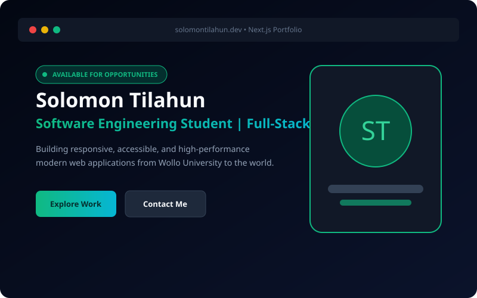

# 🚀 Solomon Tilahun - Modern Full-Stack Developer Portfolio

A modern, high-performance personal portfolio website engineered with **Next.js (App Router)**, **TypeScript**, **Tailwind CSS**, and **Framer Motion**. Designed specifically for **Solomon Tilahun**, Software Engineering Student at Wollo University & aspiring Full-Stack Developer.



---

## 🌟 Key Highlights & Design Aesthetic

- **Design Style**: Sleek Dark Theme by default with neon emerald (`#10b981`) and cyan (`#06b6d4`) glowing accents.
- **Micro-Interactions**: Ambient particle glow effects, glassmorphic card backdrops, smooth scrolling, and entrance animations via Framer Motion.
- **Responsive Architecture**: Mobile-first navigation drawer, fluid typography, and multi-device viewport scaling.
- **Dynamic Project Filtering**: Filter across All, Full Stack, Frontend, and Backend project cards with pop-up architecture modals.
- **Robust Type Safety**: Full TypeScript integration across components, data sources, and route handlers.
- **Contact Pipeline**: Form validation using **Zod** and **React Hook Form** with API route handling.
- **Downloadable CV**: Integrated resume download (`/cv-solomon-tilahun.pdf`) and printable browser CV (`/cv.html`).

---

## 🛠️ Technology Stack

| Category | Technology | Purpose |
| :--- | :--- | :--- |
| **Framework** | [Next.js](https://nextjs.org/) (App Router) | Server-side rendering, routing & API handlers |
| **Language** | [TypeScript](https://www.typescriptlang.org/) | Strict static typing and code reliability |
| **Styling** | [Tailwind CSS](https://tailwindcss.com/) | Responsive utility-first styling & dark mode |
| **Animations** | [Framer Motion](https://www.framer.com/motion/) | Smooth UI entrance, hover and layout animations |
| **Icons** | [Lucide React](https://lucide.dev/) | Clean, accessible developer iconography |
| **Form Handling** | [React Hook Form](https://react-hook-form.com/) | Client state and form input management |
| **Validation** | [Zod](https://zod.dev/) | Strict runtime schema validation |
| **Theming** | [next-themes](https://github.com/pacocoursey/next-themes) | Seamless dark and light mode toggle without flash |

---

## 📁 Project Directory Structure

```text
solomon-portfolio/
├── public/                       # Static public assets
│   ├── solomon.jpg               # Solomon's official profile photo
│   ├── cv-solomon-tilahun.pdf    # Direct downloadable PDF CV
│   ├── cv.html                   # Clean printable HTML CV
│   └── projects/                 # Project screenshots & SVG mockups
│       ├── student-management.svg
│       ├── chatbot.svg
│       ├── weather-app.svg
│       ├── cafe-management.svg
│       ├── portfolio.svg
│       ├── evangadi-forum.svg
│       ├── netflix-clone.svg
│       └── amazon-clone.svg
├── src/
│   ├── app/                      # Next.js App Router
│   │   ├── api/contact/route.ts  # Secure POST contact message endpoint
│   │   ├── globals.css           # Global Tailwind & neon glow styling
│   │   ├── layout.tsx            # Root layout with metadata & theme provider
│   │   ├── not-found.tsx         # Custom 404 page
│   │   └── page.tsx              # Main single-page portfolio layout
│   ├── components/               # Modular UI Components
│   │   ├── ui/
│   │   │   ├── Badge.tsx         # Technology badge chips
│   │   │   ├── Card.tsx          # Reusable glassmorphic cards
│   │   │   └── SectionHeading.tsx# Section title with neon badge
│   │   ├── About.tsx             # Professional bio, education & objectives
│   │   ├── BackToTop.tsx         # Floating scroll-to-top button
│   │   ├── Contact.tsx           # Validated contact form with direct links
│   │   ├── Education.tsx         # Wollo University degree & coursework
│   │   ├── Experience.tsx        # Verified project & collaboration timeline
│   │   ├── Footer.tsx            # Links, quick nav & copyright
│   │   ├── Hero.tsx              # Interactive hero, profile photo & CTAs
│   │   ├── Navbar.tsx            # Sticky header with active highlight
│   │   ├── ProjectModal.tsx      # Deep dive modal for each project
│   │   ├── Projects.tsx          # Filterable project showcase
│   │   ├── Skills.tsx            # Categorized technical abilities
│   │   └── ThemeToggle.tsx       # Dark / Light mode toggle button
│   ├── data/                     # Clean Data Separation
│   │   ├── education.ts          # Academic history & achievements
│   │   ├── experience.ts         # Verified experience items
│   │   ├── personalInfo.ts       # Contact info, bio, social URLs
│   │   ├── projects.ts           # 8 featured software projects
│   │   └── skills.ts             # Frontend, Backend, Database, Tools
│   ├── lib/
│   │   └── utils.ts              # Tailwind class merger (cn helper)
│   ├── providers/
│   │   └── ThemeProvider.tsx     # Next-themes client provider
│   └── types/
│       └── index.ts              # TypeScript interfaces & types
├── .env.example                  # Environment template
├── .gitignore                    # Git ignore configurations
├── next.config.mjs               # Next.js configuration
├── package.json                  # Node dependencies and scripts
├── postcss.config.mjs            # PostCSS configuration
├── tailwind.config.ts            # Tailwind custom colors & animations
└── tsconfig.json                 # TypeScript compiler configuration
```

---

## ⚡ Quick Start Guide (Local Development)

### 1. Prerequisites
- **Node.js** v18.18.0 or later
- **npm** or **pnpm** or **yarn**

### 2. Installation
```bash
# Clone the repository
git clone https://github.com/solomontilahun411/solomon-portfolio.git

# Navigate into project directory
cd solomon-portfolio

# Install project dependencies
npm install
```

### 3. Run Development Server
```bash
npm run dev
```
Open [http://localhost:3000](http://localhost:3000) in your browser to view the application.

---

## 🖼️ How to Update Project Screenshots & Demo Links

You can easily replace the placeholder graphics and add your live website links anytime:

1. **Add your real screenshots:**
   - Drop your PNG/JPG image files into the `public/projects/` directory (e.g. `public/projects/my-real-project.png`).
2. **Update project information:**
   - Open [`src/data/projects.ts`](src/data/projects.ts).
   - Find your project and update:
     ```ts
     image: "/projects/my-real-project.png",
     liveDemoUrl: "https://your-deployed-project.vercel.app",
     githubUrl: "https://github.com/solomontilahun411/your-repo-name",
     ```
   - Save the file; Next.js will hot-reload automatically!

---

## 🌐 Deploying to Vercel (Production)

The portfolio is fully optimized for 1-click deployment on [Vercel](https://vercel.com):

1. **Push your code to GitHub:**
   ```bash
   git init
   git add .
   git commit -m "Initial commit: Solomon Tilahun Developer Portfolio"
   git branch -M main
   git remote add origin https://github.com/solomontilahun411/solomon-portfolio.git
   git push -u origin main
   ```
2. **Import into Vercel:**
   - Log in to [Vercel](https://vercel.com) using your GitHub account.
   - Click **"Add New..."** -> **"Project"**.
   - Select your repository `solomon-portfolio`.
   - Vercel automatically detects Next.js settings.
   - Click **Deploy**!

---

## 📬 Contact & Connect

- **Solomon Tilahun**
- **Email**: [solomontilahun411@gmail.com](mailto:solomontilahun411@gmail.com)
- **Telegram**: [@sol21mariam](https://t.me/sol21mariam)
- **GitHub**: [@solomontilahun411](https://github.com/solomontilahun411)
- **Institution**: Wollo University, Kombolcha Institute of Technology (KIOT)
